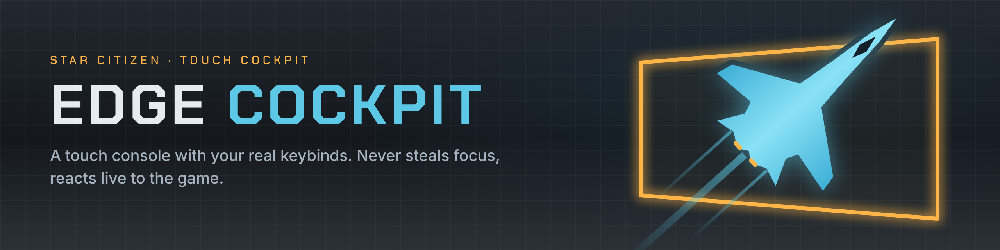
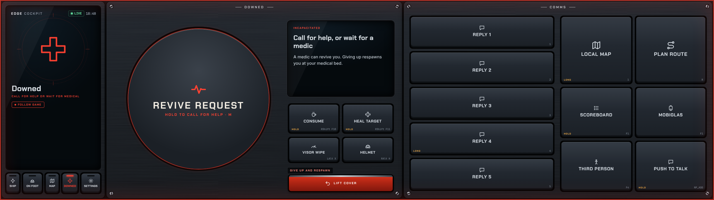
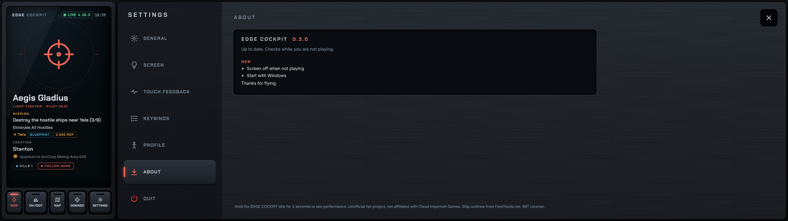

<p align="center"></p>

<p align="center">
  <a href="../../releases/latest"></a>
  <a href="../../actions/workflows/check.yml"></a>
  <a href="../../actions/workflows/security.yml"></a>
  <a href="../../actions/workflows/codeql.yml"></a>
  <a href="https://scorecard.dev/viewer/?uri=github.com/pcanilho/edge-cockpit"></a>
  <a href="https://www.bestpractices.dev/projects/16854"></a>
  <a href="../../releases/latest"></a>
  <a href="LICENSE"></a>
</p>

A lightweight cockpit-style touch console for Star Citizen. It sends your real keybinds without stealing focus from the game, and reacts live to `Game.log`.

Unofficial fan project, not affiliated with Cloud Imperium Games.


## Install

1. Download `Edge-Cockpit-<version>-setup.exe` from the [latest release](../../releases/latest) and run it.
   Windows SmartScreen warns because the app is not code signed: click **More info**, then **Run anyway**. Each release lists SHA-256 checksums and a VirusTotal scan, and carries a build provenance attestation ([how to verify](SECURITY.md#verifying-a-download)).
2. In game, open **Options > Keybindings > Advanced Controls Customization > Control Profiles**, pick **xeneon** and tick only **Keyboard**. This gives the console's actions that have no default key a free key. Your own binds stay as they are.

That's all. Edge Cockpit starts with Windows and waits in the tray with its screen dark. It wakes when Star Citizen starts and turns the screen off again when you quit. When a new release is out it asks you, with the release notes, and only while you're not playing.

It finds the touchscreen by itself (or pick one in **Settings > Screen**), and has a night mode: on, off, or automatic from 20:00 to 07:00.

## The console

Every ship page has a power plate with a big **Flight Ready** button, a module for your ship's role, a flight plate and a gear plate. The role module is a target dial for fighters, a laser power knob for mining, a beam head for salvage, a tractor beam slider for cargo, and so on. Swipe it sideways or tap the arrows to see the others. No key appears twice on a page. To rearrange the plates, long-press a plate's title, drag the plates and tap **Done**. The order is saved for each role. On foot you get a weapon wheel, your suit and comms. Downed, a big revive button.

| | |
| --- | --- |
|  |  |
| Mining | On foot |
|  |  |
| Weapons grey out in armistice zones | Red alert with a CrimeStat |
|  |  |
| The Downed page opens when you go down | Settings and what's new |

| Control | How it works |
| --- | --- |
| Keycap | Tap. Most switches are push-buttons, because the game doesn't say whether they're on |
| HOLD tag | The key stays down while you hold it |
| LONG or 2× tag | Long press or double tap for a second action |
| MACRO (cut corners) | One tap runs a sequence, such as Ready & ATC or Battle stations |
| Switch, knob | Tap or turn |
| Lever, slider | Drag |
| Red cover | Tap to lift it, then tap again within 3 seconds |

## It follows the game

- Opens the page for what you are doing: your ship's role page when you board, On foot when you leave, Downed when you go down.
- Takes your ship maker's colours and shows its outline, role and quantum target. Outlines come from [FleetYards.net](https://fleetyards.net) the first time a ship is seen and are kept on your PC. On foot it shows the ship you last flew.
- Shows where you are ("Keeger · Nyx", "Asteroid base · Ungoverned") on a line of the system's planets.
- Shows your mission: the objective, the contract with its rewards as chips, and where the objective's marker points. Game colour tags, and those of StarStrings and SmartCitizen, are read rather than shown. The game logs no distances, so there are none.
- Lights a red frame only for a CrimeStat or your ship disabled. Unmonitored or ungoverned space is an amber note.
- Reads your `actionmaps.xml`, so keys you rebound in game just work. **Settings > Keybinds** lists any key the console can't press.

The game doesn't report gear, power, doors, lights or most switches, so those are push-buttons (doors get separate Open and Close keys), and the gear lever and missiles show what you last pressed. Hold the EDGE COCKPIT title for 2 seconds to see frame rate, CPU, memory and touch-to-key latency.

No telemetry. The only network calls are ship outlines from FleetYards and the update check against these releases.

## If keys do nothing

- Keys only go to Star Citizen while it is the window in front. Turn on **Test mode** in settings to try them elsewhere.
- If the game runs as administrator, the console must too: **Run as administrator** in settings or the tray menu.
- If touches land on your main screen, run **Calibrate the pen and touch input** in Windows, pick **Setup** and touch the console's screen when asked.

## Ships

Ships are sorted into roles (light fighter, heavy fighter, multi-crew, mining, salvage, cargo, medical, ground vehicle). To move a ship, create `Documents\Edge Cockpit\ships.json`:

```json
{ "ships": { "DRAK_Cutlass_Black": "cargo", "AEGS_Gladius": { "role": "heavy-fighter", "has": ["missiles"] } } }
```

Names are class names from `Game.log`. A prefix like `AEGS_Gladius` covers every variant.

## Supported devices

Only the Corsair Xeneon Edge (2560 x 720) is fully supported for now. If you would like another touchscreen supported, open a [device request](../../issues/new?template=device.yml). More devices will come if there is demand.

## Feedback

Found a bug? Open a [bug report](../../issues/new?template=bug.yml). Have an idea? Open a [feature request](../../issues/new?template=feature.yml).
Want to help with code? See [CONTRIBUTING.md](CONTRIBUTING.md).

## Support

Edge Cockpit is free and always will be, with every feature included. If it improves your flights and you'd like to support its development, you can [sponsor the developer](https://github.com/sponsors/pcanilho).

## Security

See [SECURITY.md](SECURITY.md) for what the app can do and how to report a vulnerability privately.

## Development

The app is Tauri 2: Rust in `app/src-tauri` does the window, keys, files, screen and updates, and the console is plain HTML, CSS and JS in `app/ui`. `layouts/star-citizen.json` is the source of truth for every key.

```sh
cd app
npm ci
npm test               # Game.log reader, role pages, ship lookup
npm run test:ui        # every page: full labels, no idle work, fast touches (needs Playwright)
npx tauri dev          # run it (Windows)
```

Open `app/ui/index.html?demo=ship` from a local web server to preview the console in a browser (also `demo=armistice`, `demo=alert`, `demo=downed`, or `page=mining`). Run `node scripts/sync.mjs` in `app` first.

After a game patch, take `defaultProfile.xml` from `Data.p4k` (or a current dump such as [Boxxy-Binder's AllBinds.xml](https://github.com/BoxximusPrime/Boxxy-Binder)) and run `scripts/check_patch.py`, `scripts/build_layout.py` and `scripts/build_binds.py` on it. The ship list refreshes itself each month.

To release, add a section for the version to [CHANGELOG.md](CHANGELOG.md), set the version in `app/src-tauri/tauri.conf.json`, and run the **App** workflow with **release** ticked.

## Credits

Ship roles come from the [Star Citizen Wiki API](https://api.star-citizen.wiki). Ship outlines are fetched at runtime from [FleetYards.net](https://fleetyards.net) and are not part of this repository. Star Citizen, its ships and its logos belong to Cloud Imperium Games.

## License

[MIT](LICENSE)
