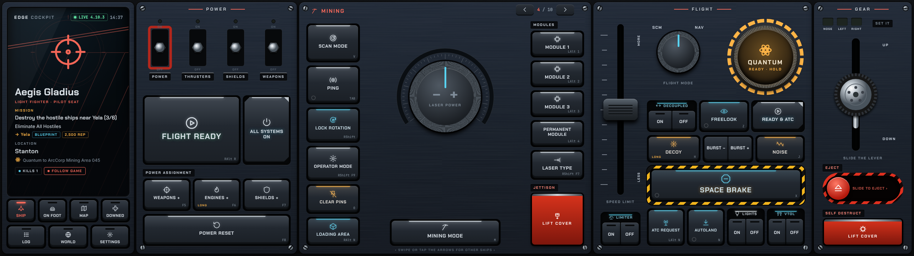
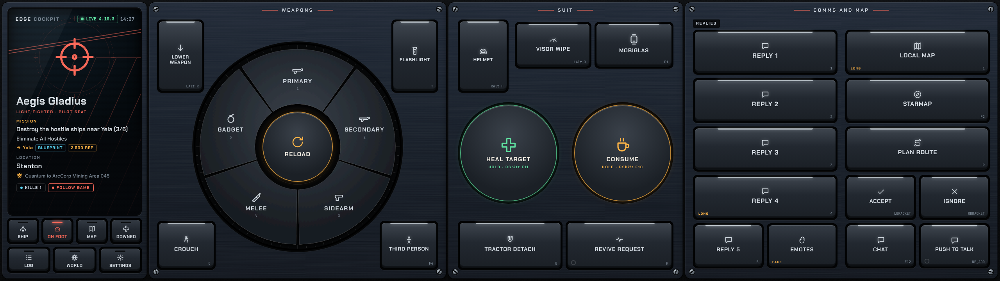
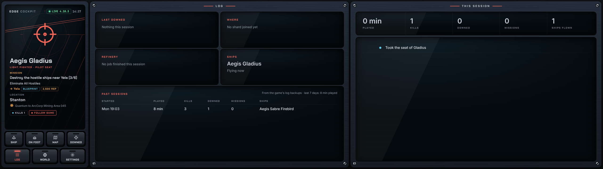
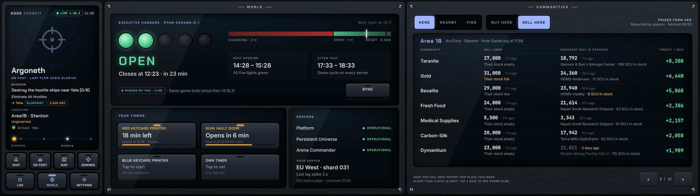
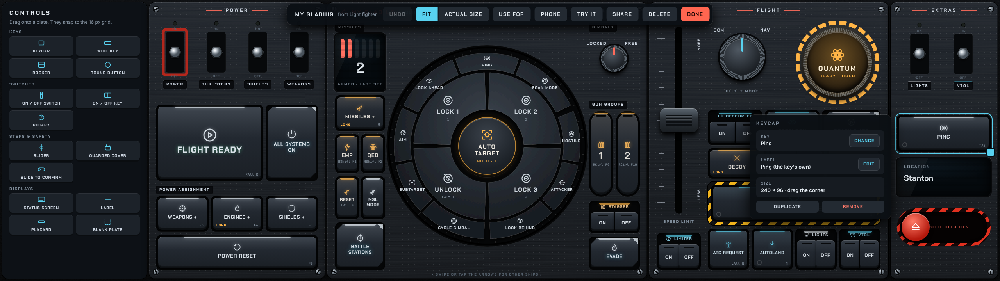
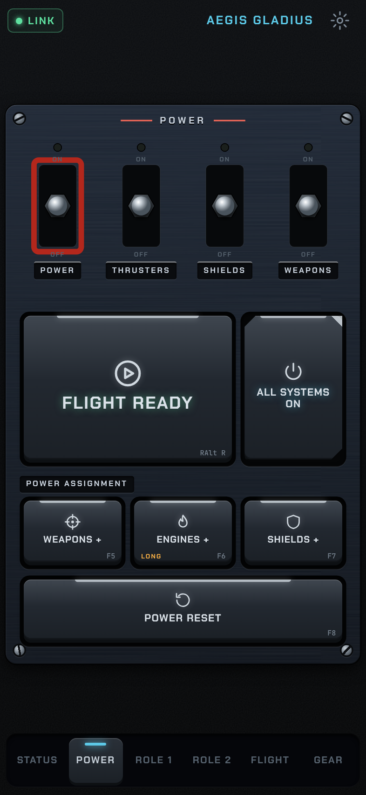
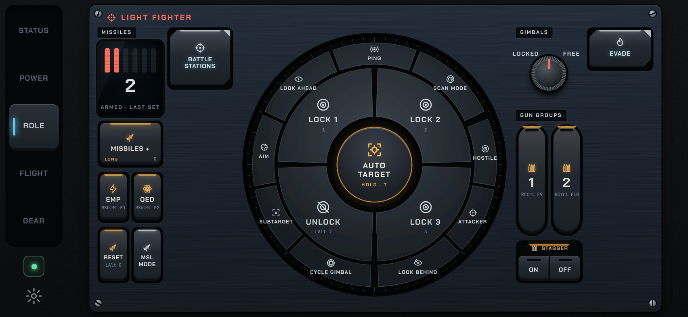

<p align="center"></p>

<p align="center">
  <a href="../../releases/latest"></a>
  <a href="../../actions/workflows/check.yml"></a>
  <a href="../../actions/workflows/security.yml"></a>
  <a href="../../actions/workflows/codeql.yml"></a>
  <a href="https://scorecard.dev/viewer/?uri=github.com/pcanilho/edge-cockpit"></a>
  <a href="https://www.bestpractices.dev/projects/16854"></a>
  <a href="../../releases/latest"></a>
  <a href="LICENSE"></a>
</p>

A touch cockpit for Star Citizen. Presses your own keybinds without taking focus from the game, and follows `Game.log` live.

Unofficial fan project, not affiliated with Cloud Imperium Games.


## Install

1. Run `Edge-Cockpit-<version>-setup.exe` from the [latest release](../../releases/latest). SmartScreen warns because the exe isn't code signed: **More info** > **Run anyway**. [How to verify a download](SECURITY.md#verifying-a-download).
2. In game: **Options > Keybindings > Advanced Controls Customization > Control Profiles**, pick **edge-cockpit**, tick only **Keyboard**. This binds actions that have no default key. Your own binds stay. On first start a setup check shows what's ready, with a **Test a key** button.

It starts with Windows, wakes when Star Citizen starts and goes dark when you quit. Updates are offered only while you're not playing.

## Pages

- **Ship**: power plate with **Flight Ready**, a role module (target dial, mining laser, salvage beam, tractor beam...), flight and gear plates. Long-press a plate's title to rearrange or swap the role module, long-press a key to swap it; both saved. On another screen, pick which plates it shows.
- **Build your own pages**: long-press a ship page's title, then **New blank page** or **Duplicate & edit**. Drag controls from the palette onto a plate (16 px grid), tap one to pick its key, label and size. Switches take only actions with set-on and set-off binds, eject-type keys only a cover or slide. A **Sequence** key sends up to six keys in turn (for example limiter on, gear down, lights on, ATC). Undo, Try it (no keys sent), phone preview, Fit or Actual size. **Use for** picks the ships it replaces the ship page of. **Share** saves it to `Documents\Edge Cockpit\Pages`; **Import** adds one from there. A tablet or PC showing the whole console can edit it too, live on the Edge.
- **On foot**: weapon wheel, suit, comms, emotes.
- **Downed**: revive request.
- **MFD & assists**: MFD screens, light amplification, auto precision, wind compensation, Self repair all.
- **Log**: this session's stats, who downed you, region and shard, last jump, refinery jobs, a timeline, and past sessions from the game's log backups.
- **World**: executive hangar cycle (you sync it; hidden after a patch until you sync again), keycard printer and Ruin vault door timers, RSI server status, and the market where you are: buy and sell here, nearby, or find any commodity. Prices and stock are player reports from [UEX](https://uexcorp.space), each with its age. If the page doesn't know where you are, **Locate** (on foot) opens your inventory for a moment so `Game.log` names the place.

| | |
| --- | --- |
|  |  |
|  |  |
|  |  |
|  | |

| Control | How it works |
| --- | --- |
| Keycap | Tap |
| HOLD | Held while you hold it |
| LONG / 2× | Long press or double tap for a second action |
| MACRO (cut corners) | Runs a sequence |
| ON/OFF switch | Top half on, bottom half off. Unlit until set |
| Gear lever | Slide up or down. Sits in the middle until you move it |
| Slider, knob | Drag or turn. Each step goes to the game, which keeps the value, so no number is shown |
| Red cover | Tap to lift, tap again within 3 s |

## It follows the game

From `Game.log` it opens the right page and shows your ship, mission, location, quantum target, injuries, hangar queue and alerts (restricted areas, low fuel, party invites, why the game dropped you). Behind the status display sits a render of your ship from [FleetYards.net](https://fleetyards.net), fetched once and kept. Ships from Drake, Aegis, Origin, MISC, Anvil, RSI, Crusader, Argo and Consolidated Outland get their maker's theme (**Settings > Screen**), where **Large labels** also lives. The frame goes red only for a CrimeStat or a disabled ship.

It reads your `actionmaps.xml`, so rebound keys just work. **Settings > Keybinds** lists any it can't press. It keeps the last 5 versions in `Documents\Edge Cockpit\Binds`: when a game update wipes your binds, **Restore** puts them back as a Control Profile.

The game doesn't report most switch states, so nothing is guessed: ON/OFF switches stay unlit and the gear lever stays centred until you set them. **All systems on** sets them all. Toggle-only actions are push-buttons.

If a patch changes the log lines it reads, an amber **Log lines missing** chip says so, with a button to report it.

No telemetry. Network calls: FleetYards for ship images (once per ship), GitHub for updates, and while the World page is open, UEX for prices (every 30 min) and RSI's status page (every 5 min).

## If keys do nothing

- **Settings > General > Setup check** shows what's off.
- Console smaller than the screen, or in a corner? **Refit** in **Settings > Screen**. **Identify screens** shows which screen is which.
- Keys only reach the game while it's in front. **Test mode** sends them anywhere.
- Game running as administrator? So must the console: **Run as administrator** in settings or the setup check.
- Touches land on the wrong screen? Windows **Tablet PC Settings** > **Setup**, then tap the touchscreen when asked.

## Ships

Each ship has a role. To change one, create `Documents\Edge Cockpit\ships.json`:

```json
{ "ships": { "DRAK_Cutlass_Black": "cargo", "AEGS_Gladius": { "role": "heavy-fighter", "has": ["missiles"] } } }
```

Use `Game.log` class names; a prefix covers every variant.

## Supported devices

Corsair Xeneon Edge (2560 x 720). On another touchscreen, **Settings › Screen** picks which plates it shows and Fit or Actual size, and you can build your own pages for it. Other sizes: open a [device request](../../issues/new?template=device.yml).

Phones, tablets and other PCs on your network join as extra screens: **Settings › Devices**, turn it on and scan the code (or open `http://edge-cockpit.local:47823`). No app to install. A phone shows one plate at a time; a tablet or another PC shows the whole console. Give a device one plate, or move a plate off the Edge onto it. Only paired devices can press keys.

|  |  |
|---|---|

## Feedback

[Bug report](../../issues/new?template=bug.yml) · [Feature request](../../issues/new?template=feature.yml) · [Contributing](CONTRIBUTING.md)

## Support

Free, every feature. [Sponsor](https://github.com/sponsors/pcanilho) if you'd like.

## Security

[SECURITY.md](SECURITY.md): what the app can do and how to report a vulnerability.

## Development

Tauri 2: Rust in `app/src-tauri` (window, keys, files, updates), plain HTML/CSS/JS in `app/ui`. Every key comes from `layouts/star-citizen.json`.

```sh
cd app
npm ci
npm test               # Game.log reader, role pages, ship lookup
npm run test:ui        # every page: full labels, no idle work, fast touches (needs Playwright)
npm run dev            # run it
```

Browser preview: run `node scripts/sync.mjs` in `app`, then serve `app/ui` and open `index.html?demo=ship` (also `armistice`, `alert`, `downed`, `disabled`, `log`, `hangar`, or `page=mining`).

After a game patch: run `scripts/check_patch.py`, `build_layout.py` and `build_binds.py` on the new `defaultProfile.xml` (or [Boxxy-Binder's AllBinds.xml](https://github.com/BoxximusPrime/Boxxy-Binder)). The ship list refreshes monthly (`refresh-ships.yml`).

Release: add the version to [CHANGELOG.md](CHANGELOG.md) and `tauri.conf.json`, then run the **App** workflow with **release** ticked.

## Credits

Ship roles: [Star Citizen Wiki API](https://api.star-citizen.wiki). Commodity prices: [UEX](https://uexcorp.space), reported by players. Ship outlines and renders: [FleetYards.net](https://fleetyards.net), fetched at runtime, not in this repository. Star Citizen, its ships and logos belong to Cloud Imperium Games.

## License

[MIT](LICENSE)
